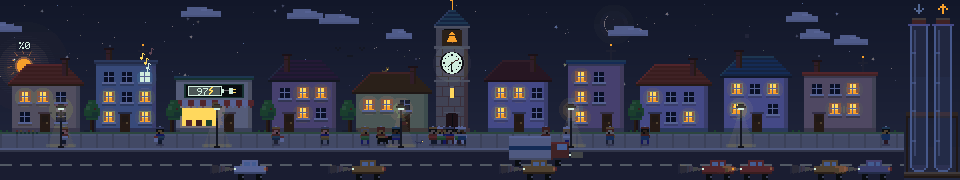
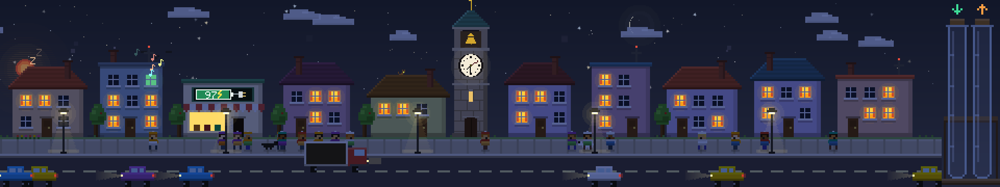
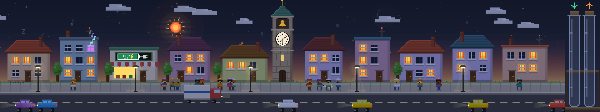
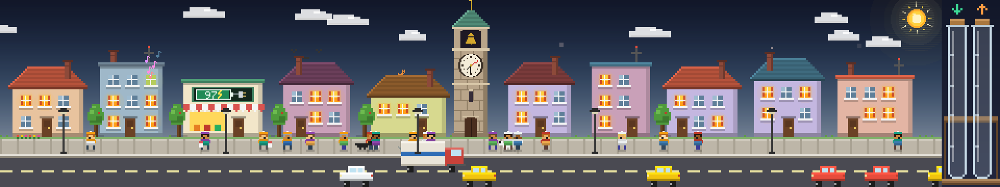
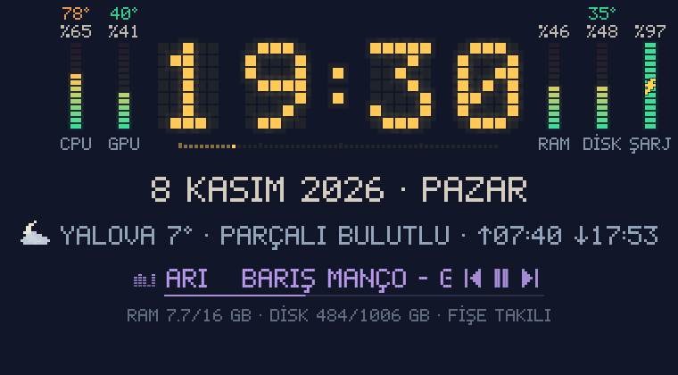

# Pixel Mahalle

Masaüstünde duran küçük bir piksel mahalle. Güneş ve müzik düğmeleri dışında hiçbir yeri tıklanmaz, tıklamalar masaüstüne geçer. Evler, yürüyen insanlar, köpekler, arabalar ve taşınma kamyonu; mahallenin hareketi bilgisayarın CPU/GPU yüküne ve sıcaklığına göre değişir.



| Gece (parlaklık %0) | Şafak | Gündüz (parlaklık %100) |
|---|---|---|
|  |  |  |



## Mahalle neyi gösteriyor?

Mahalle, bilgisayarın o anki durumunu canlı olarak yansıtır. Değerler 2 saniyede bir güncellenir.

| Mahallede gördüğün | Temsil ettiği | Nasıl okunur |
|---|---|---|
| 🚶 Kaldırımda yürüyen insanlar | **İşlemci (CPU) kullanımı** | %0'da sokak boş, %100'de her 220 px'lik sokak parçasında 14 yaya |
| 🚗 Yoldaki arabalar | **Ekran kartı (GPU) kullanımı** | %0'da yol boş, %100'de her 220 px'te 8 araba (`nvidia-smi` gerekir) |
| 🔥 Bacalardan çıkan duman | **Ekran kartı (GPU) sıcaklığı** | 45 °C altında arada bir ince duman çıkar. 85 °C'ye doğru yoğunlaşır ve kızarır, en sıcakta baca ağızları kor gibi parlar ve kıvılcım atar |
| 💡 Sarı yanan pencereler | **İşlemci sıcaklığı** | 40 °C'de hepsi sönük, 110 °C'de hepsi yanık |
| 🧪 Sağdaki yeşil tüp (↓) | **İndirme hızı** | Logaritmik: boş = 1 KB/s, dolu = 100 MB/s |
| 🧪 Sağdaki turuncu tüp (↑) | **Yükleme hızı** | Tüp üzerindeki her çizgi 10 kat artış demek |
| ☀️ Gökyüzündeki güneş | **Ekran parlaklığı** | En solda batmış (%0, gece), sağa gittikçe yükselir, en sağda öğle güneşi (%100). Sürükleyince parlaklık değişir |

Tüplerdeki çizgiler sırasıyla 10 KB/s, 100 KB/s, 1 MB/s ve 10 MB/s'yi gösterir. Trafik arttıkça kabarcıklar da hızlanır.

Mahalle ekranın alt kenarı boyunca tüm genişliği kaplar. İlk beş evden sonrası ekran genişliğine göre otomatik dizilir.

Taşınma kamyonu, bahçıvan ve kuşlar yalnızca süs; bir ölçümü temsil etmez.

## Saat ve hava durumu

Ekranın ortasında büyük bir LED piksel saat durur: saat, saniye çubuğu, Türkçe tarih ve Yalova'nın anlık hava durumu. Hava [Open-Meteo](https://open-meteo.com)'dan 15 dakikada bir çekilir (anahtar gerekmez), son veri `~/.cache/pixel-mahalle/hava.json`'da saklanır.

Mahallenin havası da Yalova'yı izler:

| Yalova'da | Mahallede |
|---|---|
| Açık | Yıldızlar, gerçek evresinde ay, ara sıra kayan yıldız |
| Bulutlu | Bulut sayısı bulutluluğa göre artar |
| Yağmur / sağanak | Damlalar, sıçramalar, şemsiyeler, su birikintileri, ıslak asfaltta lamba yansıması; şemsiyesi olmayan koşar |
| Kar | Kar taneleri; çatılar, ağaçlar ve kaldırım yavaşça beyazlar, kar tutunca kardan adam çıkar |
| Fırtına | Şimşek çakar, gökyüzü aydınlanır |
| Sis | Süzülen sis bulutları, lambaların etrafında hare |
| Rüzgâr | Ağaçlar daha çok sallanır, baca dumanı ve yağış yana yatar |
| 8 °C altı | Herkes bere ve atkı takar |

## Saatin yanındakiler

- **Göstergeler:** Saatin solunda CPU ve GPU, sağında RAM, disk ve pil için dikey LED çubuklar var. Her çubuğun üstünde kullanım yüzdesi, sensörü olanların en üstünde sıcaklık yazar (CPU, GPU, NVMe/SATA disk, sensörlü RAM); serinken yeşil, ısındıkça sarı ve kırmızı. Fişe takılıyken pilin üstünde şimşek çıkar, dolarken dolum dalgası yukarı akar. En altta GB değerleri ve kalan pil süresi yazar.
- **Çalan şarkı:** MPRIS yayınlayan her oynatıcı okunur, Firefox ya da Chrome'da açılan YouTube Music dahil. Saatte ekolayzer, kayan şarkı adı, ilerleme çubuğu ve önceki / oynat-duraklat / sonraki düğmeleri çıkar. Saatte tıklanabilen tek yer bu düğmeler. Duraklatılan şarkı 10 dakika daha görünür kalır, devam ettirilebilsin diye. Mahallede apartmanın üst penceresinde renkli ışık yanar, pencereden notalar uçar.
- **Gün doğumu/batımı:** Yalova için hesaplanır (↑ ↓). O saatlerin 45 dakika öncesi ve sonrasında gökyüzü turuncu-mor renge döner.

## Güneş ve parlaklık

Gökyüzündeki güneş ekran parlaklığının sürgüsüdür. Üstüne gelince el imleci ve yüzde balonu çıkar.

- Sağa sürükledikçe güneş çatıların ardından yükselir. Önce ufuk şafak kızıllığına boyanır, sonra gökyüzü açık maviye döner. Yıldızlar ve ay söner, lambalar kapanır, renkler aydınlanır. Gün doğarken kuşlar havalanır.
- Sola sürükledikçe güneş kızarıp alçalır ve en solda çatıların ardına batar. Mahalle gece olur, batmış güneşten Zzz yükselir.
- Tutunca güneş büyür ve ışınları hızlanır. Bırakınca yaylanarak yerine oturur.
- Parlaklık tuşlarla değişirse güneş de kayarak yeni yerine gider.
- Parlaklık root gerekmeden logind üzerinden yazılır (`/sys/class/backlight`). %0, ekran tamamen kararmasın diye donanımın en kısığına değil %5'ine denk gelir.
- Parlaklık ayarlanamayan makinelerde güneş yalnızca mahalleyi aydınlatır. Hiç sürüklenmezse mahalle gece kalır, `--day` verilirse saate göre değişir.

## Mahalle hayatı

- **Saat kulesi:** Geniş ekranda mahallenin ortasında durur. Kadranında gerçek saat görünür (akrep, yelkovan ve kırmızı saniye ibresi), gece kadran ışır. Saat başlarında çan, saat kaçsa o kadar sallanır, ses halkaları yayılır ve kuleden güvercinler havalanır.
- **Pil tabelası:** Dükkân tabelası pil göstergesine dönüşür ve yüzdeyi gösterir. Fişe takılıyken yanında kablo ve fiş, içinde şimşek çıkar.
- **Uyku:** 5 dakika klavye ve fareye dokunulmazsa (`--uyku DK`) ışıklar tek tek söner, millet evine girer, evlerden Zzz yükselir. Ağaçta baykuş belirir, çatıdaki kedi kıvrılıp uyur, saat kısılır. Dokununca hepsi uyanır.
- **Özel günler:**
  - 23 Nisan, 19 Mayıs, 15 Temmuz, 30 Ağustos ve 29 Ekim'de çatılarda Türk bayrağı dalgalanır. 29 Ekim akşamı havai fişek atılır.
  - 10 Kasım'da bayraklar yarıya iner.
  - Ramazan ve Kurban bayramlarında saçaklara fener dizilir. Tarihler `takvim.py`'deki tablodan gelir, ±1 gün tahminidir.
  - 20 Aralık'tan itibaren yılbaşı ışıkları yanar ve saatte geri sayım çıkar. 31 Aralık gece yarısı havai fişek atılır.
  - `--dogum-gunu GG.AA` verilirse o gün kapılara balon bağlanır.
- **Cuma pazarı:** Cuma 17:00-23:00 arası kaldırımda meyve tezgâhı kurulur, yayalar alışverişe uğrar.
- **Sokak hayatı:** Çatıda turuncu bir kedi gezer. Sokak kedileri geçer, köpek yaklaşınca kaçar. 07:00-11:30 arası simitçi, kasım-mart akşamları "BOZAAA" diye bağıran bozacı geçer. Gece 00:00-04:00 arası eve dönen biri kapıda anahtarını arar, girince penceresi bir süre yanar.

Denemek için: `./mahalle.py --hava kar` (`acik`, `parcali`, `bulutlu`, `sis`, `cisenti`, `yagmur`, `saganak`, `kar`, `firtina`). Saati kapatmak için `--saat-yok`.

## Gereksinimler

- Linux (X11/Wayland, GTK 3)
- Python 3, `python3-gi`, `python3-gi-cairo`
- İsteğe bağlı: `nvidia-smi` (GPU kullanımı için)

```bash
sudo apt install python3-gi python3-gi-cairo gir1.2-gtk-3.0
```

## Çalıştırma

```bash
./mahalle.py
```

Seçenekler: `--scale N` (piksel boyutu, HiDPI'de otomatik küçülür), `--day` (parlaklık ayarlanamıyorsa saate göre gündüz/gece). Wayland'de XWayland varsa otomatik olarak X11 kullanılır, böylece pencere sağ alta yerleşir.

Sıcaklık sensörü bulunamazsa `/sys/class/thermal` yedek olarak denenir.

## Test

```bash
python3 -m unittest -v
```
